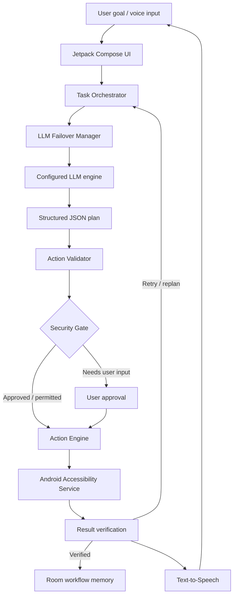

# SuperiOA

<p align="center">
  <strong>An intelligent Android task-orchestration assistant</strong><br/>
  <sub>Plan with AI. Validate every action. Execute on-device. Verify the result.</sub>
</p>

<p align="center">
  <a href="https://github.com/pcmdk369/rss/actions"></a>
  
  
  
  
  
</p>

<p align="center">
  <a href="#overview">Overview</a> ·
  <a href="#features">Features</a> ·
  <a href="#architecture">Architecture</a> ·
  <a href="#quick-start">Quick start</a> ·
  <a href="#configuration">Configuration</a> ·
  <a href="#security-model">Security</a> ·
  <a href="#development">Development</a>
</p>

---

## Overview

**SuperiOA** is an Android-first task-orchestration assistant developed under **PCMDK369**. It uses a configured large language model (LLM) to interpret a user's goal and propose a structured action plan. The Android application validates that plan, applies security checks, performs permitted actions through Android's Accessibility framework, and verifies the outcome.

The core design principle is simple:

> **The model plans; the Android application decides what is valid and what may execute.**

SuperiOA is an automation research / MVP project—not a promise of unrestricted device control or guaranteed compatibility with every third-party application.

## At a glance

| Area | Current implementation |
|---|---|
| Application | Native Android app |
| Primary language | Kotlin |
| UI | Jetpack Compose + Material 3 |
| Minimum Android version | Android 8.0 (API 26) |
| Compile / target SDK | 34 / 34 |
| Java target | 17 |
| Local persistence | Room |
| Network client | OkHttp |
| LLM protocol | OpenAI-compatible chat completions |
| Automation | Android AccessibilityService |
| Voice | OpenAI Realtime speech-to-speech over native WebRTC; legacy Admin Voice uses Android Speech Recognition + native TTS |
| Local security | EncryptedSharedPreferences, Android Keystore-backed protection, validation and approval gates |
| Build output currently documented | Debug APK (not a signed production release) |

## Features

### AI task orchestration
- Converts a natural-language goal into a strict JSON action plan.
- Validates action names, parameters and plan structure before execution.
- Runs a bounded plan / execute / verify / replan loop.
- Supports cancellation through the Stop control.
- Uses sequential LLM-engine failover for planning requests.

### Android interaction
- Executes supported actions through the Android Accessibility service.
- Includes navigation, tapping, typing, scrolling, swiping, reading visible UI and other generic device actions.
- Routes sensitive or high-impact interactions through security checkpoints.
- Uses the Android main thread for Accessibility reads and actions.

### Multiple LLM engines
- Supports configuration for up to five engines.
- Each engine has its own enabled state, API key/token, HTTPS base URL, model ID and timeout settings.
- Provider-neutral: no vendor, company, model or API host is preselected. Configure any service that implements the OpenAI-compatible `POST {base-url}/chat/completions` contract.
- The app accepts the provider's API key/token, base URL and exact model ID. Compatibility depends on the provider supporting the expected chat-completions request/response format.
- Optional build-time defaults use `LLM_ENGINE_API`, `LLM_PROVIDER_URL` and `LLM_MODEL`; all may be left blank and configured in the app. Values are not hardcoded.
- Records engine attempts and failure reasons in task results.
- Failover is limited to planning calls; it does not retry a device-side tap or send action merely because a model request failed.

### Voice interaction
- Voice input can start recognized commands when Accessibility and an LLM engine are ready.
- Native Android TTS speaks task results.
- Admin Voice Mode provides an authenticated foreground listening flow with a visible notification and Stop action.
- TTS initialization is shared across the app; speech requested while initialization is pending is queued.

### Local memory and diagnostics
- Stores task history and workflow information locally using Room.
- Reuses eligible workflows only when app context and confidence checks pass.
- Keeps task outcome, engine and summary information for local review.
- Redacts obvious secrets from diagnostic logging.

## Architecture

The model is not given direct access to Android execution APIs. Every proposed action passes through the app's validation and security boundary.



### Execution boundaries

| Component | Responsibility |
|---|---|
| **Orchestrator** | Coordinates planning, execution, cancellation and verification |
| **FailoverManager** | Tries configured engines in sequence for planning requests |
| **Engine adapter** | Sends requests using the supported provider protocol |
| **ActionValidator** | Rejects malformed or unsupported model actions |
| **SecurityGate** | Detects sensitive checkpoints and requests user approval where required |
| **ActionEngine** | Maps approved generic actions to Android operations |
| **AccessibilityService** | Reads and interacts with visible, accessible UI elements |
| **Room memory** | Stores local task and verified workflow history |
| **Speaker** | Handles native Android text-to-speech output |

### Action execution

The current generic action vocabulary includes:

`OPEN_APP`, `BACK`, `HOME`, `RECENTS`, `NOTIFICATIONS`, `QUICK_SETTINGS`, `TAP`, `LONG_PRESS`, `TOGGLE`, `TYPE`, `CLEAR_TEXT`, `SELECT_ALL`, `SCROLL`, `SWIPE`, `COPY`, `PASTE`, `READ_UI`, `WAIT`, `VERIFY`, `RETRY`, `ABORT`, and `REQUEST_USER`.

Execution is bounded: up to 5,000 planning rounds per task, 50,000 total actions per task, 12 actions per model reply, and two retries per action. These are safety ceilings, not a promise that a task will complete.

## Quick start

### Option A — Download a CI APK

No Android Studio installation is required to try the available debug build.

1. Open [GitHub Actions](https://github.com/pcmdk369/rss/actions).
2. Open the successful **Build SuperiOA APK** workflow run.
3. Download the `SuperiOA-debug-apk` artifact.
4. Extract the archive and install `app-debug.apk` on your Android device.

A previously documented successful CI run is [run 40446241841](https://github.com/pcmdk369/rss/actions/runs/40446241841), for commit `ffb471b6ac1bfe2643f55fe0c1c14b3f8e082cdf`. It passed unit tests and assembled a debug APK. CI compilation is not equivalent to a physical-device smoke test.

### Option B — Build from source

**Requirements**
- Android Studio with Android SDK 34
- JDK 17
- Gradle 8.9 (for the documented command-line build)
- Git

1. Clone the repository:

   ```bash
   git clone https://github.com/pcmdk369/rss.git
   cd rss
   ```

2. Open the project in Android Studio and allow Gradle sync to complete. If required, let Android Studio generate the Gradle wrapper for the project.
3. Build and run unit tests:

   ```bash
   gradle :app:testDebugUnitTest :app:assembleDebug
   ```

4. Find the debug APK:

   ```text
   app/build/outputs/apk/debug/app-debug.apk
   ```

## First-run setup

1. Launch SuperiOA and review the permissions / disclosure information.
2. Open Android Accessibility settings using the in-app action.
3. Enable **SuperiOA** and accept Android's system confirmation.
4. Open **Settings → LLM engines**.
5. Enable at least one engine and configure its API key, HTTPS base URL and exact model ID.
6. Configure the Realtime gateway under **Settings → Realtime Voice Gateway**.\n7. Return to **Voice**, tap **Start Voice**, and speak naturally. Device tasks are routed to the Android orchestrator when Accessibility is enabled.
7. Review and respond to any security or approval prompt. Use **Stop** to cancel an active task.

The app requires a compatible configured endpoint. A key or environment variable stored on a separate server is not automatically available to the installed Android application.

## Configuration

### LLM engine settings

Configure each engine in the app's Settings screen. The supported request convention is:

```http
POST {BASE_URL}/chat/completions
Content-Type: application/json
Authorization: Bearer <API_KEY>
```

Use the provider's correct HTTPS base URL and model identifier. The endpoint must implement the expected OpenAI-compatible chat-completions request/response format.

The repository's `.env.example` documents the environment naming convention. These names do not automatically configure an installed app; use the in-app settings unless you have separately implemented a secure backend integration.

**Never commit API keys, access tokens, private endpoints or signing credentials.** Do not share credentials in GitHub issues, screenshots or logs.

## Admin Voice Mode

Admin Voice Mode is an optional, explicitly started foreground microphone workflow.

- Enrollment requires Android device authentication and a private multi-word passphrase.
- Microphone and notification permissions are required.
- The active session is shown through an ongoing Android notification with a Stop action.
- A recognized instruction must begin with the enrolled passphrase; the prefix is removed before the command reaches the existing orchestrator.
- A partial wake lock may keep the CPU active and increase battery consumption.
- A fresh manual authentication/start is required after reboot.

**Security note:** a spoken passphrase is not voice biometrics and may be recorded or replayed. Do not use a banking PIN, account password or another existing secret as the phrase. Android's configured speech-recognition provider may process audio. Sensitive actions remain subject to the app's security flow.

## Security model

SuperiOA is designed around a validate-before-execute approach.

- Model output is treated as untrusted input.
- Only supported, schema-validated generic actions can reach the executor.
- Sensitive checkpoints can pause execution and request user input or approval.
- API keys are stored in encrypted on-device preferences; diagnostic output uses secret redaction.
- No API key or private signing keystore should be committed to source control.
- LLM failover is restricted to planning calls to avoid accidentally replaying device-side effects.

### Important privacy consideration

Visible screen text may be sent to the LLM provider configured by the user so the model can interpret the current task. Passwords are excluded and obvious secrets are redacted, but users should still avoid exposing highly sensitive screens to an external provider. Use a trusted endpoint and secure device.

## Technical stack

| Layer | Technology |
|---|---|
| Language | Kotlin |
| UI | Jetpack Compose, Material 3 |
| Android components | AndroidX Activity, Core, Lifecycle, Biometric |
| Persistence | Room |
| Local encrypted preferences | AndroidX Security Crypto |
| HTTP / signaling | OkHttp + WebRTC |
| Serialization | kotlinx.serialization |
| Async execution | Kotlin Coroutines |\n| Realtime media | WebRTC Android SDK (`io.github.webrtc-sdk:android`) |
| Database code generation | KSP |
| Unit testing | JUnit 4 |
| Device automation | Android AccessibilityService |

## Project status

SuperiOA is an actively evolving MVP. The following distinctions matter:

| Capability | Status |
|---|---|
| Five-engine configuration and sequential failover | Implemented; unit tests written |
| Generic action validation and bounded orchestration | Implemented; CI-compiled |
| Accessibility-based interaction | CI-compiled; physical-device testing required |
| Local workflow memory | Implemented |
| Realtime speech-to-speech over WebRTC | Implemented in PR; Android CI and physical-device testing required |\n| Legacy Admin Voice foreground mode | Implemented; device and environment dependent |
| Admin foreground voice mode | Implemented; device and environment dependent |
| Browser interaction | Basic visible-UI interaction; no DOM bridge or OCR fallback |
| OCR / vision provider | Not implemented |
| Web search API | Not implemented |
| Bundled on-device LLM | Not implemented |
| Realtime audio streaming | Implemented in PR; provider and device validation pending |
| Production release signing | Not configured; current documented artifact is a debug APK |
| Supabase sync | Not integrated; an optional RLS schema is present |
| Cost / token usage estimates | Not implemented |
| Full OpenJarvis desktop/server stack | Not part of this Android app |

For the detailed requirement-by-requirement status, see **[CHECKLIST.md](CHECKLIST.md)**.

## OpenJarvis-inspired design

SuperiOA incorporates selected architectural ideas from [OpenJarvis](https://github.com/open-jarvis/OpenJarvis), adapted for a native Android application. This is not a wholesale port of the upstream Python / Rust / desktop project.

The Android implementation includes model catalog metadata, replaceable engine adapters, agent profiles, extensible skills, trace-informed engine ordering and local task-trace analysis. All device actions remain behind SuperiOA's validator, security gate and Accessibility executor.

See **[docs/OPENJARVIS_INTEGRATION.md](docs/OPENJARVIS_INTEGRATION.md)** for the integration principles, mapping, acceptance criteria and remaining work.

## Known limitations

- Android background-activity restrictions can prevent an app from opening another activity while it is in the background.
- Apps that hide content from Accessibility, including some banking apps, games and secure windows marked `FLAG_SECURE`, may not be readable or controllable.
- Third-party app UI changes can break automation flows.
- Speech recognition depends on the Android speech service, installed language data, permissions and network conditions.
- Android may stop foreground work; force-stop, battery policies and manufacturer-specific restrictions can affect long-running sessions.
- A debug APK signed by a temporary CI key may not install as an update over an APK signed with a different key. Uninstalling the old app can remove its local data.
- The current CI artifact is not a production-signed release.

## Troubleshooting

<details>
<summary><strong>App says “Update failed” or “App not installed”</strong></summary>

A clean GitHub-hosted runner may generate a different debug signing key. Android rejects an update when the signing certificate does not match. Use the newest artifact. If you do not need the old app's local data, uninstall the previous build before installing; uninstalling deletes local app data.

For stable future updates, configure a private persistent signing keystore through GitHub Actions secrets. Never commit the keystore or password.
</details>

<details>
<summary><strong>Android blocks Accessibility with “Restricted setting”</strong></summary>

Some sideloaded apps are subject to Android's restricted-settings protection. Open SuperiOA's App info and check the overflow menu for **Allow restricted settings**. Availability and wording depend on Android version and device manufacturer.

Alternatively, install from a trusted development computer using ADB, then enable the Accessibility service manually in Android settings. ADB installation does not automatically grant Accessibility permission. Never enable USB debugging for an untrusted computer.
</details>

<details>
<summary><strong>LLM request fails</strong></summary>

Check that an engine is enabled, the API key is valid, the base URL uses HTTPS, and the model ID is exact. Confirm that the provider supports the expected `/chat/completions` route and OpenAI-compatible payload format. Do not append the route twice if the configured base URL already includes it.
</details>

<details>
<summary><strong>Admin Voice Mode is silent</strong></summary>

Check microphone and notification permissions, Android's default speech-recognition service, installed speech language data, media volume and the TTS engine. For TTS diagnostics from a connected development computer:

```bash
adb logcat -s SuperiOA-TTS
```

The log can help identify initialization or playback errors; it does not prove that speech was audible on the device.
</details>

<details>
<summary><strong>Automation cannot read or interact with an app</strong></summary>

Confirm that SuperiOA's Accessibility service is enabled and the target app is visible in the foreground. Some secure screens and custom-rendered interfaces intentionally expose little or no accessible UI.
</details>

## Tests and validation

Unit tests are located under `app/src/test`. Existing test coverage includes action validation, failover ordering and retry behavior, cancellation, secret redaction and workflow confidence decisions.

Run:

```bash
gradle :app:testDebugUnitTest
gradle :app:assembleDebug
```

A successful build verifies compilation and the tests that ran. It does **not** establish that every device, Android version or third-party application workflow works. Physical-device smoke testing and security review remain necessary.

## Contributing

Contributions, bug reports and focused improvements are welcome.

1. Check existing issues before opening a duplicate.
2. Describe the problem, Android version and reproducible steps.
3. Keep changes focused and add or update unit tests.
4. Preserve the action validation and security-gate boundary.
5. Never include API keys, personal data, private logs or signing secrets in a pull request.
6. Clearly label behavior that has only been tested in CI and not on a physical device.

For larger architectural changes, open an issue first to discuss the approach.

## Project documentation

- [Requirements and implementation checklist](CHECKLIST.md)
- [OpenJarvis integration plan](docs/OPENJARVIS_INTEGRATION.md)
- [GitHub Actions](https://github.com/pcmdk369/rss/actions)
- [Repository](https://github.com/pcmdk369/rss)

## Maintainer

**PCMDK369**  
Project: **SuperiOA**  
Repository: [github.com/pcmdk369/rss](https://github.com/pcmdk369/rss)

---

<p align="center">
  <sub>Built with Kotlin and Android · AI-assisted planning with user-controlled execution</sub><br/>
  <strong>Think independently. Protect your vision. Explore beyond.</strong>
</p>
